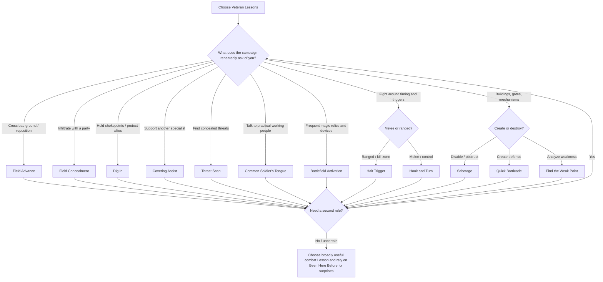

# Veteran Lessons in Iteration D.4: Ranking, Interaction, and Pruning Report

## Executive Summary

The **Veteran Lesson system is fundamentally sound**, and the strongest part of Iteration D.4 is not that every Lesson is equally useful—it is that the subclass now has enough adaptation machinery that some Lessons are allowed to be **excellent in the right campaign and mediocre elsewhere**. *Been Here Before*, Short-Rest swapping, the level-15 temporary Lesson, and Battlefield Readiness substantially reduce the usual punishment for printing campaign-dependent martial options. That is exactly the environment in which things like **Field Concealment, Battlefield Activation, Common Soldier's Tongue, Sabotage, and Quick Barricade** can succeed.

My main conclusion after checking the Lessons against the actual 2024 action rules is that **the biggest problem is not power imbalance between Lessons. It is redundancy and a few rules-assumption errors.**

Three findings matter most.

**First, Opportunity Attack specialization is not intrinsically dangerous here.** Hook and Turn's `1d10` rider is modest in sustained DPR because an Opportunity Attack first has to occur and then has to hit. At a 65% base hit chance, an extra `1d10` on an attack adds about **3.85 expected damage per actual OA attempt** when critical hits are accounted for. If a character gets a relevant OA in only 25%, 50%, or 75% of rounds, the rider contributes roughly **0.96, 1.93, or 2.89 DPR**, respectively. The more important component is the 5-foot repositioning, particularly in a Sentinel build. Even there, the one-Reaction limit is an effective governor. The 2024 Reaction rules allow only one Reaction until the start of your next turn, and D.4 deliberately retains that limit. citeturn18view1

**Second, Hair Trigger is substantially less of a raw-damage monster than its text initially looks.** Extra Attack applies to the Fighter's Attack action on its turn, whereas Hair Trigger explicitly creates its own two- and later three-attack exception for the off-turn readied Attack action. Ready consumes the Veteran's action now, the Reaction later, and can fail entirely if the trigger never occurs. citeturn18view1turn18view4 Under a simple `d10 + 5`, 65%-hit model, a level 7–10 Fighter's ordinary two attacks are worth about **14.2 expected damage**; Hair Trigger is worth about **18.05 if the trigger definitely fires**, but only **14.44 at an 80% trigger probability**. Its break-even trigger reliability is about **79%**. At level 11, a normal three-attack action already beats Hair Trigger's two attacks plus `1d10` even with a guaranteed trigger, before considering Finish the Wounded. At levels 15+, Hair Trigger again reaches three attacks, but the Veteran's ordinary on-turn Attack action also carries `2d10` Finish the Wounded against an injured target. Thus Hair Trigger is properly a **timing and interception Lesson**, not an obvious sustained-DPR selection.

**Third, three current Lessons need structural work: Forced March, Fire-Team Assist, and Threat Scan.** Forced March is not weak in severe difficult terrain, but it is too closely crowded by Break Contact, Tactical Shift, and especially the 2024 Speedy feat. Fire-Team Assist contains an actual rules-assumption problem: the 2024 Help action does **not** generally require adjacency for ability-check assistance; it says the ally must merely be near enough for verbal or physical assistance, with the DM deciding feasibility. citeturn18view0 Threat Scan has a subtler problem: a normal creature using the 2024 Hide action immediately stops being hidden when it makes an attack roll, so the clause rewarding you for searching for a creature that “has made an attack” often comes online exactly when Search has become unnecessary. citeturn18view0 Its “since the end of your last turn” trigger is also awkward with Battlefield Readiness on the Veteran's first turn, since there may have been no previous turn in the combat.

My recommended overall disposition is:

| Lesson | General Rank | Niche Ceiling | Recommendation |
|---|---:|---:|---|
| **Forced March** | C+ | A | **Merge** with Break Contact |
| **Break Contact** | B | A | **Merge** with Forced March |
| **Field Concealment** | B | S | **Keep** |
| **Shield the Line** | B+ | A | **Merge** with Hold Ground |
| **Hold Ground** | C+ | A | **Merge** with Shield the Line |
| **Fire-Team Assist** | C | B+ | **Rework** |
| **Threat Scan** | C+/B- | A | **Rework wording**, then keep |
| **Hair Trigger** | A- | A+ | **Keep** |
| **Hook and Turn** | A- | A+ | **Keep** |
| **Common Soldier's Tongue** | B- | S | **Keep as campaign Lesson** |
| **Battlefield Activation** | C+/B- | S | **Keep as campaign Lesson** |
| **Sabotage** | B- | S | **Keep** |
| **Quick Barricade** | B | S | **Keep**, clarify physical limits |
| **Find the Weak Point** | B- | A+ | **Keep**, despite some Veteran's Eye overlap |

The ideal next list is therefore probably **twelve Lessons rather than fourteen**: merge the two Dash Lessons, merge the two Dodge Lessons, rewrite Fire-Team Assist, and make a surgical correction to Threat Scan. Twelve lands directly in the 10–14 range recommended by the earlier research while increasing the difference between each selection.

The prior optimizer landscape also argues against treating all Reaction attacks as dangerous by default. Legacy 2014 optimization heavily emphasized Action Surge nova and combinations such as Polearm Master/Sentinel, while current 2024 discussions note that those old packages no longer interact in exactly the same way; the 2024 Fighter instead already carries significant control through Weapon Mastery and Tactical Master. citeturn19search0turn19search8turn19search5turn16search0 The correct question for Hook and Turn is therefore not “does it interact with an Opportunity Attack?” but “how often can this Veteran actually generate qualifying Opportunity Attacks, what else competes for the Reaction, and what control does one successful OA buy?” On those questions, D.4 is much less alarming than the earlier report's most conservative interpretation.

## Rules Framework and Evaluation Assumptions

The prior report's conclusions as reproduced in the design brief remain the governing constraints: Lessons should enhance actions the Veteran was already taking, rather than recreate Iteration A's attack-replacement engine; utility actions need not become damage-neutral with Attack; Tactical Master should not be duplicated through stacked mastery riders; and campaign-dependent abilities are acceptable because the subclass now has deliberate adaptability.

The published 2024 chassis reinforces those principles. Fighter already receives Weapon Mastery at level 1, Action Surge and Tactical Mind at level 2, Tactical Shift at level 5, Tactical Master at level 9, Studied Attacks at level 13, and progressively larger Attack actions at levels 5, 11, and 20. Action Surge grants one additional action but explicitly excludes the Magic action. Tactical Mind can add `1d10` after a failed ability check by spending Second Wind, while Tactical Shift converts Second Wind into additional no-OA movement. citeturn18view4turn16search0

That matters because a Lesson does not have to solve every problem itself. A Veteran making a crucial Field Concealment, Sabotage, Threat Scan, Size Up, Influence, or Find the Weak Point check can already invoke **Tactical Mind after failure**. This is a particularly elegant interaction: the Lesson creates a new useful way to engage with the world, while the Fighter chassis supplies reliability rather than the subclass printing another generic numeric bonus. citeturn18view4

### Analytical assumptions

For numerical illustrations, I use a **65% normal hit probability**, which is a conventional optimization benchmark rather than a rule of the game. Critical hits occur on 5% of attacks unless otherwise stated. A representative weapon hit is modeled as `1d10 + 5`; this is not intended to model every Fighter build, only to translate Lesson riders into understandable magnitudes.

Campaign assumptions are:

- **Dungeon crawl:** frequent combat, doors, traps, rooms, cover, ambushes, limited but nonzero social play.
- **Urban intrigue:** infiltration, guards, laborers, factions, social interaction, locks, buildings, relatively fewer open-field fights.
- **Siege/fortress:** fortifications, chokepoints, cover, artillery/ranged threats, military NPCs, engineering and sabotage.
- **Wilderness patrol:** distance, difficult terrain, camps, tracking, ambushes, scouting, fewer constructed objects.
- **High-magic/artifact:** frequent charged items, relics, magical mechanisms and unusual equipment, with ordinary adventuring encounters still present.

The **pick-rate percentages below are analytical estimates, not survey data**. They mean “estimated percentage of informed Veteran players who would permanently know this Lesson at some point if told the campaign premise in advance.” Because a Veteran knows several Lessons, columns do not sum to 100%.

Community optimization material is used only to establish optimizer priorities, not as rules authority. Tabletop Builds' older 2014 Fighter work strongly prioritized Action Surge nova, and its old melee Fighter discussions illustrate how much optimizer culture once revolved around PAM/Sentinel-style off-turn control; those are useful historical baselines but must not be imported wholesale into 2024. citeturn19search0turn19search8 Current 2024 discussion instead regularly evaluates Fighters through Weapon Mastery, revised GWM, Action Surge, and the changed relationship between Polearm Master and Sentinel. citeturn19search5turn19search7

### Why full actions deserve substantial enhancements

The 2024 rules make the opportunity cost stark. At level 5, an Attack action normally produces two attacks; at level 11, three; at level 20, four. citeturn18view4 Therefore a Veteran who Dodges, Helps, Searches, Studies, Utilizes, or Readies instead of attacking is surrendering a substantial part of the Fighter chassis.

This is the central balancing principle I would use for every Lesson:

> **A full-action Lesson can be visibly strong without being overpowered, because the Fighter is paying for it with one of the game's most attack-dense actions.**

This is also why a Lesson like Quick Barricade can reasonably create actual Half Cover rather than a tiny `+1` rider. Half Cover is itself only `+2 AC` and `+2 Dexterity saving throws`, and cover does not stack additively with better cover. citeturn15search0turn15search1

## Lesson Catalog and Individual Rankings

### Core mechanical catalog

| Lesson | Prerequisite | Cost | Frequency | Exact D.4 enhancement | Dependence |
|---|---|---|---|---|---|
| **Forced March** | None | Dash action | Unlimited | +10 ft. movement for that Dash; ignore Difficult Terrain for turn | Terrain |
| **Break Contact** | None | Dash action | Unlimited | Choose visible creature; your movement doesn't provoke its OAs that turn | Enemy positioning |
| **Field Concealment** | None | Hide action | Group buff 1/SR or LR | Ignore armor Stealth Disadvantage on Hide; after successful Hide, up to PB allies get Hide Advantage and ignore armor Disadvantage for 10 min. | High |
| **Shield the Line** | None | Dodge action | Unlimited | Adjacent willing ally gains Half Cover until next turn while remaining adjacent | Formation |
| **Hold Ground** | None | Dodge action | Unlimited | Advantage against Prone/forced movement; reduce no-check forced movement by 10 ft. | Enemy control |
| **Fire-Team Assist** | None | Help action | Unlimited | Extended Help ranges; successful helped attack gives attacker 5-ft. safe move | Moderate |
| **Threat Scan** | None | Search action | Unlimited | Advantage locating recently active creature; direction clue; first attack against one located creature gets Advantage | Hidden enemies |
| **Hair Trigger** | Fighter 7 | Ready action + Reaction | Unlimited | Readied Attack gets 2 attacks, 3 at L15; one hit gets +1d10 | Trigger reliability |
| **Hook and Turn** | Fighter 7 | Opportunity Attack + Reaction | Unlimited | OA hit +1d10; move Large-or-smaller target 5 ft. within reach | OA frequency |
| **Common Soldier's Tongue** | Fighter 10 | Influence action | Unlimited | Advantage in defined practical interactions with soldiers/workers/etc. | Social premise |
| **Battlefield Activation** | Fighter 10 | Magic action + optional BA | Unlimited | Magic-item activation allows draw/stow; afterward one BA weapon/unarmed attack | Magic-item access |
| **Sabotage** | Fighter 10 | Utilize action | Unlimited | Advantage disabling/obstructing nonmagical device/object; establishes reversal DC | Environment |
| **Quick Barricade** | Fighter 10 | Utilize action | Unlimited | Suitable material becomes a temporary edge granting Half Cover | Material/terrain |
| **Find the Weak Point** | Fighter 10 | Study action | Unlimited | Learn plausible physical weakness; first qualifying attack/check gets Advantage | Objects/structures |

### Forced March — **C+ general, A in the right terrain**

Forced March looks modest on an open battle map and excellent on genuinely bad ground. The ordinary Dash action grants extra movement equal to Speed. citeturn11view3 A Speed-30 Veteran normally has 60 feet of movement available after Dashing; Forced March raises that to 70. That is only a **16.7% increase** on an unobstructed turn.

In an all-Difficult-Terrain route, however, the difference is enormous. An ordinary Speed-30 Dash supplies 60 movement points but each foot costs 2, giving about **30 feet of displacement**. Forced March supplies 70 and turns off the extra Difficult Terrain cost for the whole turn, allowing roughly **70 feet**. In mud, rubble, trenches, ice, undergrowth, wreckage, or broken fortifications, it can more than double actual traversal.

The problem is not that the Lesson is too weak. The problem is **option-list efficiency**. The 2024 Speedy feat already includes a Speed increase and a benefit for Dashing through Difficult Terrain. citeturn17view3 Tactical Shift also gives Fighters resource-limited no-OA repositioning when they use Second Wind. citeturn16search0 And Break Contact occupies the exact same Dash-action slot while solving another mobility problem.

**Verdict:** good effect, poor use of a separate printed Lesson. Merge it with Break Contact.

### Break Contact — **B general, A for mobile melee**

Break Contact is considerably better than it first appears because it makes **Dash serve as a partial Disengage without losing the Dash movement**. Against one dangerous melee creature, the Veteran can double their movement and ignore that creature's OA rather than spending the action on Disengage and traveling only their base movement.

It is also appropriately worse than Rogue mobility. A Rogue can use Cunning Action for recurring Bonus Action movement, while the Veteran still spends the entire action. The 2024 Rogue explicitly retains Cunning Action access to Dash, Disengage, and Hide as Bonus Actions. citeturn18view5

It overlaps Tactical Shift, but only partially. Tactical Shift costs Second Wind and occurs with a Bonus Action; Break Contact is resourceless but consumes the action. citeturn16search0 That is healthy differentiation.

**Verdict:** keep the concept but merge it with Forced March into one robust **Field Advance** Lesson.

### Field Concealment — **B general, S in infiltration campaigns**

This is one of the best examples of the niche philosophy working correctly.

The 2024 Hide action is quite restrictive: the creature must make a DC 15 Dexterity (Stealth) check while Heavily Obscured or behind Three-Quarters or Total Cover and be outside enemy line of sight. Successful hiding grants Invisible until one of several breaking events occurs. citeturn18view0 Field Concealment does **not** waive any of those spatial requirements. That is crucial to keeping it out of Rogue territory.

Its mathematical effect can nevertheless be dramatic. Suppose a Strength Fighter has only `+2` Stealth. Against DC 15:

- normal success: **40%**;
- with Disadvantage from armor: **16%**;
- with Advantage after the Field Concealment group benefit: **64%**.

For a competent `+5` Stealth ally, normal success is **55%** and Advantage raises it to **79.75%**.

That is a legitimate party-level infiltration benefit. Yet the Veteran does not gain Expertise, recurring Bonus Action Hide, relaxed cover requirements, or the Thief's ability to remain hidden after attacking. The 2024 Rogue already owns those stronger specialist patterns, including Cunning Action and Thief-specific stealth enhancements. citeturn18view5

There is also a very good internal interaction with Tactical Mind. The Veteran must **successfully Hide first** to start the 10-minute group benefit; Tactical Mind can rescue a failed initial Stealth check by adding `1d10`. citeturn18view4 That makes the feature more dependable without needing more text.

A Rogue dip improves it because Cunning Action can change the cost of a later Hide to a Bonus Action. That is real synergy, but Fighter 3/Rogue 2 is already a meaningful five-level investment, and the Lesson still does not relax the Hide prerequisites. I do not regard this as abuse.

**Verdict:** keep unchanged or nearly unchanged. This is exactly what a “water subclass in an ocean campaign” option should look like.

### Shield the Line — **B+ general, A in defensive formations**

Dodge is already a substantial self-defense action: attacks against the dodging creature have Disadvantage when it can see the attacker, and the dodger has Advantage on Dexterity saves, subject to the action's normal restrictions. citeturn11view2 Shield the Line adds Half Cover to an adjacent ally, which means `+2 AC` and `+2` to Dexterity saves. citeturn15search0

Numerically, if an attacker would normally hit the ally 65% of the time, +2 AC reduces that to about 55%, a roughly **15% relative reduction in attack damage**. Against a 50% base hit chance it falls to 40%, a **20% relative reduction**. Multiply that across several enemy attacks plus Dexterity-saving-throw effects and the rider can matter.

The Veteran is paying heavily: at levels 11+, Dodge means abandoning three attacks. That prevents the ability from becoming an every-round passive bodyguard feature. It is best when the Veteran actually wants to Dodge anyway: holding a doorway, protecting a concentrating caster, tanking a boss's multiattack, surviving until reinforcements arrive.

This is a healthy support design because **the Veteran protects by physically occupying a space**, not by issuing commands or handing out abstract bonuses.

**Verdict:** good, but its shared Dodge trigger with Hold Ground makes a merge attractive.

### Hold Ground — **C+ general, A against forced-movement encounters**

Hold Ground's general pick rate should be low, but its ceiling is real. If a forced-movement or Prone effect normally gives a character a 55% chance to resist, Advantage raises that success probability to **79.75%**; failure drops from 45% to 20.25%, a **55% reduction in the chance of failure**.

Against monsters that shove people from bridges, flying enemies that throw targets, earth/telekinetic effects, collapsing ships, or encounters built around Prone and hazards, that is excellent.

The trouble is list economics. A player looking for an evergreen Dodge Lesson almost certainly picks Shield the Line first. Hold Ground then asks for a **second known-Lesson slot to improve the same expensive action**. Because the effects stack automatically when both are known, the current list is practically inviting the defensive Veteran to buy a two-part package.

**Verdict:** not bad enough to delete on power grounds; redundant enough to merge with Shield the Line.

### Fire-Team Assist — **C and requires rules correction**

This is the current list's clearest mechanical drafting problem.

For ability checks, the 2024 Help action does **not** say the ally must be adjacent. It requires an ally “near enough” for the helper to assist verbally or physically, requires the helper to choose a skill or tool proficiency, and leaves feasibility to the DM. citeturn18view0 Therefore:

> “the creature you help can be within 30 feet rather than adjacent”

is modifying a restriction that the base rule does not actually contain.

The attack portion is rules-cleaner. Base Help against an enemy requires that enemy to be within 5 feet of you and gives one ally Advantage on its next attack. citeturn18view0 Extending that to 15 feet is useful. The 5-foot safe movement after a hit is also tactically interesting.

The issue is output. At a 65% base hit probability, Advantage raises the hit probability to 87.75%, a gain of **22.75 percentage points**. Giving Advantage to one ordinary ally attack is usually worth only a few expected damage points. The Veteran may have sacrificed two, three, or eventually four attacks to produce it. The 5-foot movement sometimes makes the trade worthwhile, but not often enough.

That does not mean Help should equal an Attack action in DPR. It means a Veteran who spends their entire turn helping ought to produce **a clearly distinctive support result**.

**Verdict:** rework. Do not merely fix the 30-foot wording.

### Threat Scan — **C+/B- as written, A potential after a small rewrite**

Threat Scan has an excellent conceptual niche and two rules problems.

Search is the correct action: the 2024 Search action uses Wisdom to find nonobvious things, with Perception specifically covering concealed creatures and objects and Survival covering tracks. citeturn3view3 Battlefield Readiness's free opening Sweep is therefore a strong architectural pairing.

But the current trigger says the Veteran has Advantage if the creature “has moved, made an attack, or made a clearly audible sound since the end of your last turn.”

The **attack clause is frequently redundant**. Under the standard 2024 Hide rules, a hidden creature stops being hidden immediately after it makes an attack roll. citeturn18view0 Thus an ordinary hidden archer that shoots the Veteran has already exposed itself; the Veteran generally does not need Search to “spot the shooter.” The clause matters against exceptional creatures that remain concealed after attacking, but that is a much narrower category.

The **first-turn timing is also awkward**. Battlefield Readiness says Sweep occurs at the start of the Veteran's first turn, but “since the end of your last turn” may describe no interval at all before the Veteran has taken a turn in that combat.

This validates your earlier instinct that **“Spot the Shooter” by itself was not worth a Lesson**. The useful gameplay is broader: detecting something because it has left evidence, disturbed cover, moved through the environment, made a sound, or otherwise given itself away.

The reward—Advantage on the first attack against one located creature—is reasonable. It does not extract a stat block and does not become a standing attack buff. At level 13, Studied Attacks grants Advantage after a miss, but that operates through attacking rather than Search, so the overlap is modest. citeturn16search0

**Verdict:** keep the concept, rewrite the evidence trigger.

### Hair Trigger — **A- overall; best at levels 7–10 and in ranged/defensive play**

The 2024 Ready action requires spending an action now, defining a perceivable trigger, and then spending the character's Reaction after that trigger finishes; the character may also ignore the trigger. citeturn18view1 Since Fighters normally gain their Extra Attack scaling on Attack actions on their own turns, Hair Trigger's explicit two and later three attacks are doing real work. citeturn18view4

But the cost is severe enough that the feature is not an automatic DPR upgrade.

Using the illustrative `1d10 + 5`, 65%-hit attack:

| Level | Ordinary attacks | Raw ordinary attack EV* | Hair Trigger if trigger fires | Approx. trigger reliability needed just to match raw attacks |
|---|---:|---:|---:|---:|
| 7–10 | 2 | 14.2 | 18.05 | **78.7%** |
| 11–14 | 3 | 21.3 | 18.05 | **Impossible** |
| 15–19 | 3 | 21.3 | 25.15 | **84.7%** |
| 20 | 4 | 28.4 | 25.15 | **Impossible** |

\*Before subclass riders, feats, masteries, or other conditional effects.

And this table actually **overstates Hair Trigger's relative damage at levels 15+**, because a normal Veteran Attack action against a wounded creature also has Finish the Wounded's `2d10`, whereas the off-turn readied action does not satisfy “Attack action you take on your turn.”

The Lesson therefore shines when **timing is more valuable than immediate output**: an enemy is expected to emerge from Total Cover, enter a kill zone, fly into bow range, start crossing a doorway, or expose itself only briefly.

Action Surge produces an interesting but fair interaction. The Fighter can Attack normally and spend Action Surge to Ready, because Action Surge allows any extra action except Magic. citeturn18view4 But the alternative is simply using Action Surge for another immediate Attack action—which also gives Finish the Wounded another trigger because the subclass explicitly keys that damage to each Attack action. Optimized nova usually favors the immediate Attack unless delaying the attacks has tactical value.

For the same reason, revised Great Weapon Master is less concerning here than its 2014 ancestor. The current feat is built around Heavy Weapon Mastery and Hew rather than the old universal `-5/+10` model. citeturn20search4 Public 2024 rules analyses also note that the Heavy Weapon Mastery damage is tied to qualifying on-turn Attack-action attacks, reducing its relevance to off-turn readied attacks and OAs. citeturn10search4

Sharpshooter is a natural synergy, but not an explosive one: the 2024 feat improves ranged reliability by addressing cover, melee firing, and long range rather than adding the old `+10` damage rider. citeturn17view2

**Verdict:** keep. Do not nerf it merely because it generates multiple reaction attacks. Watch trigger wording in play.

### Hook and Turn — **A- for melee Veterans; A+ with the right control build**

Hook and Turn is strong, but the raw damage component is not a major balance hazard.

If `1d10` is added to a hit and critical dice are doubled, the expected value per OA attempt at a 65% base hit chance is approximately:

\[
0.60(5.5)+0.05(11)=3.85
\]

That becomes the following sustained DPR under assumed OA opportunities:

| Qualifying OA opportunity per round | Expected extra DPR from the `1d10` rider |
|---:|---:|
| 25% | **0.96** |
| 50% | **1.93** |
| 75% | **2.89** |
| 100% | **3.85** |

The conclusion is important: **even an implausibly reliable one OA every round does not make the `1d10` rider a large sustained-DPR engine.** The control rider is more consequential.

The base OA occurs when a visible creature leaves reach using qualifying movement, and it consumes the character's Reaction. citeturn3view2turn18view1 The Veteran is therefore competing with Vigilant Response, Hair Trigger, feat Reactions, and any other Reaction they possess. That one-Reaction economy is a powerful self-balancing mechanism.

Sentinel is the most important interaction. The 2024 feat is officially summarized as providing **Guardian** and **Halt**. citeturn17view1 Where Guardian produces an actual Opportunity Attack, Hook and Turn applies; a successful combination can therefore produce the normal weapon hit, `+1d10`, the 5-foot Hook and Turn reposition, and Sentinel's movement control. This is legitimately strong lockdown, but it costs a General feat, a known Lesson, melee positioning, the one Reaction, and a successful hit. That is a reasonable specialized package, not a subclass-breaking baseline.

Polearm Master is less synergistic than the name “Reactive Strike” initially suggests. The 2024 feat is officially organized around Pole Strike and **Reactive Strike**, rather than simply reproducing its legacy wording. citeturn17view0 Current rules analyses distinguish Reactive Strike from an Opportunity Attack; consequently, Hook and Turn should **not** trigger merely because Polearm Master produced a Reactive Strike unless the final feat text at the table specifically labels that attack an OA. citeturn10search13 This is one reason current 2024 optimizer discussion describes the old PAM/Sentinel package as less seamless than it was in 2014. citeturn19search5

Weapon Mastery can still matter on the OA. Tactical Master lets the Fighter substitute Push, Sap, or Slow for an applicable weapon's mastery property when attacking, expanding the Fighter's control vocabulary at level 9. citeturn16search0 That can create interesting positional combinations with Hook and Turn, but the subclass is not stacking a *second* mastery property—the explicit mistake avoided from Applied Mastery.

**Verdict:** keep. This is a good premium melee Lesson and not, by itself, an excessive DPR engine.

### Common Soldier's Tongue — **B- generally, S in military/urban campaigns**

The current Influence rules make this narrower than its text may initially suggest. The DM first determines whether an NPC is willing, unwilling, or hesitant. A willing NPC normally complies without a check; an unwilling NPC does not comply; the ability check is principally relevant in the uncertain middle. citeturn11view0

Thus Common Soldier's Tongue's Advantage does **not** function as social mind control and does not automatically matter every time the Veteran talks to a guard. It matters when a relevant guard, mercenary, dockworker, caravaner, sailor, laborer, or soldier is plausibly persuadable but uncertain.

That is an excellent niche.

It is also meaningfully different from Bard identity. The Veteran does not gain Expertise, does not become broadly better at all Charisma checks, does not alter NPC attitudes, and does not create magical compulsion. Tactical Mind can help rescue the occasional failed roll, which is exactly the sort of general Fighter reliability the subclass should exploit. citeturn18view4

In a courtly intrigue campaign dominated by aristocrats and arcane scholars, this may be close to dead. In a war campaign, dockside campaign, caravan game, frontier city, revolution, occupation, or mercenary sandbox, it can become one of the Veteran's defining abilities.

**Verdict:** emphatic keep. Low general pick rate is not evidence of design failure here.

### Battlefield Activation — **C+/B- generally, S in an item-rich campaign**

The Magic action covers action-time spells, features, and magic items requiring a Magic action. citeturn18view3 Battlefield Activation correctly selects only the magic-item branch.

The Lesson is also much safer than it looks around Action Surge. Action Surge says the additional action cannot be the Magic action. citeturn18view4 Battlefield Activation does not change the item's Magic action into another action, so it does not circumvent that limitation.

A Veteran can legally do:

> **Magic item with normal action → Battlefield Activation BA attack → Action Surge → Attack action**

but the ability to take a non-Magic Action Surge after using the character's ordinary action on Magic already follows from Action Surge's wording. The Lesson is adding only the **one Bonus Action attack**.

Under the representative model, that attack is worth roughly 7 expected damage before special weapon features. That is good but not remotely equivalent to compressing an entire Fighter Attack action.

Bonus Action competition is a meaningful limiter:

- Second Wind occupies the Bonus Action. citeturn18view4
- Polearm Master has a Bonus Action attack component. citeturn17view0
- various GWM and multiclass features can also seek that economy.
- a character only gets one Bonus Action on the turn.

The Thief comparison is especially reassuring. The official 2024 Rogue update states that Thief can activate qualifying Magic-action magic items **as a Bonus Action** and later gains stronger magic-item privileges such as an extra attunement slot, charge conservation, and broad Spell Scroll use. citeturn18view5 Battlefield Activation is dramatically less intrusive: the Veteran still pays the **full Magic action**, merely retaining one martial attack afterward.

A Veteran 10/Thief 3 does not create two Bonus Actions. If the Thief uses Fast Hands to compress a magic item into the Bonus Action, there is no second Bonus Action left for Battlefield Activation's weapon attack. That is anti-synergistic rather than abusive.

**Verdict:** keep. It is a model campaign-dependent Lesson.

### Sabotage — **B- general, S in siege/heist play**

Sabotage is strong primarily because it turns an activity players frequently negotiate informally with the GM into a predictable mechanical competency.

The 2024 Utilize action is the appropriate hook for objects requiring an action to use. citeturn11view1 The Lesson's closed verbs—disable, jam, wedge, tangle, break, obstruct—are much safer than an open “dirty trick” permission.

Advantage plus Tactical Mind makes the Veteran unusually reliable at practical interference without granting Rogue-style Expertise. citeturn18view4 The reversal DC is also useful because it gives the GM a ready answer to “how hard is it for the guard to undo what I did?”

A Thief multiclass can potentially improve the action economy of suitable object interactions. That is a legitimate synergy, but a Veteran 10/Thief 3 is already character level 13 and has paid three Rogue levels to specialize in precisely this kind of interaction. It is not a compelling reason to weaken the base Lesson.

**Verdict:** keep.

### Quick Barricade — **B general, S in siege or defense play**

Half Cover is concrete enough to matter: `+2 AC` and `+2 Dexterity saves`. citeturn15search0 Unlike Shield the Line, Quick Barricade persists after the Veteran stops spending actions, so it becomes excellent whenever the party controls preparation time and physical terrain.

That creates one edge case worth watching: **preparation spam**.

The current Lesson has no frequency limit. Given a pile of crates, furniture, doors, mantlets, rubble, or timber and several minutes, a Veteran can create many protected edges. In a siege campaign, that is arguably a feature rather than a bug—the entire point is that the Veteran is good at rapidly fortifying positions. The protection also is not magical, cover does not stack with better cover, and the barricades gain no extra durability. citeturn15search0turn15search1

I would therefore **not impose an arbitrary per-rest limit**. Instead make the physical constraint explicit: each barricade requires enough actual material to occupy and block that edge, and the same object or material cannot simultaneously form several barricades.

Its mild redundancy with Shield the Line is acceptable. Quick Barricade dominates in static, material-rich positions; Shield the Line works immediately in an empty room and moves with the formation.

**Verdict:** keep; clarify material accounting rather than nerfing it.

### Find the Weak Point — **B- general, A+ in object-heavy scenarios**

The 2024 Study action calls for an Intelligence check to draw important information from memory, books, clues, or another source; Investigation explicitly covers traps and gadgetry, while other skills cover appropriate bodies of knowledge. citeturn18view2 Find the Weak Point fits comfortably within that framework.

There is real overlap with Veteran's Eye's Field Assessment:

- Field Assessment can identify visible damage or vulnerability after one minute.
- Find the Weak Point can identify a practical point of failure in one Study action and attaches a mechanical Advantage rider.

That is **not enough overlap to make the Lesson dominated**. One is slow, broad, and baseline; the other is fast, selectable, and tactical.

Battlefield Readiness further improves it. From Fighter 10 onward, a Veteran who knows Find the Weak Point can use the free opening **Assess** on an appropriate structure/object, turning what would normally be a whole-action Study into first-turn preparation. This is precisely the kind of cross-feature interaction the architecture should encourage.

It remains controlled because the subject is nonmagical and the GM only identifies a plausible weakness actually supported by its construction or condition. It does not create vulnerability, bypass HP, or reveal arbitrary stat-block numbers.

**Verdict:** keep.

## Synergy, Conflict, and Redundancy Analysis

### The most important interaction families

The current Lessons are healthier when analyzed by **competition for actions** than by looking only at their printed bonuses.

| Pair / interaction | Relationship | Severity | Design conclusion |
|---|---|---:|---|
| Forced March ↔ Break Contact | Both improve Dash; often wanted in same situations | **High redundancy** | Merge |
| Shield the Line ↔ Hold Ground | Both improve Dodge and automatically stack if both known | **Medium-high redundancy** | Merge |
| Shield the Line ↔ Quick Barricade | Both create Half Cover for allies | Medium | Keep both; mobile/immediate vs persistent/material |
| Sabotage ↔ Quick Barricade | Both utilize physical objects | Medium thematic, low mechanical | Keep both |
| Threat Scan ↔ Find Weak Point | Search vs Study; creatures vs structures | Low-medium | Keep after Threat Scan rewrite |
| Find Weak Point ↔ Veteran's Eye | Both identify physical weakness | Medium | Keep; tactical vs 1-minute baseline |
| Hair Trigger ↔ Hook and Turn | Both consume Reaction | **High action-economy conflict**, low redundancy | Healthy choice pressure |
| Hair Trigger ↔ Vigilant Response | Both consume Reaction | High competition | Healthy |
| Hook and Turn ↔ Vigilant Response | Both consume Reaction | High competition | Healthy |
| Hook and Turn ↔ Sentinel | Sentinel can create/upgrade qualifying OA opportunities | Strong synergy | Powerful but acceptable |
| Hook and Turn ↔ Polearm Master | PAM Reactive Strike is not generally treated as an OA | Weak/competitive | Less dangerous than legacy PAM/Sentinel |
| Field Concealment ↔ Rogue | Rogue changes Hide economy | Synergy | Acceptable multiclass payoff |
| Battlefield Activation ↔ Thief | Both touch magic items but want same BA | Mostly conflict | Safe |
| Threat Scan ↔ Battlefield Readiness | Free first-turn Search | Strong intended synergy, **current wording flaw** | Fix trigger timing |
| Find Weak Point ↔ Battlefield Readiness | Free first-turn Study | Strong intended synergy | Keep |
| Any check Lesson ↔ Tactical Mind | `+1d10` rescue after failure | Strong chassis synergy | Desirable |

### Reaction congestion is a feature, not a bug

A melee Veteran can plausibly know Hook and Turn and Hair Trigger while also possessing Vigilant Response, Sentinel, and Polearm Master. That sounds alarming until the core Reaction rule is applied: after using a Reaction, the character cannot take another until the start of its next turn. citeturn18view1

This means those features are mostly **competing triggers**, not additive attacks.

A turn cycle might present all of these possibilities:

- enemy misses Veteran → Vigilant Response;
- enemy leaves Veteran's reach → OA + Hook and Turn;
- Sentinel condition occurs → potentially qualifying OA;
- Hair Trigger's declared condition occurs → readied Attack;
- PAM's Reactive Strike condition occurs → Reaction attack.

The Veteran normally chooses **one**.

That creates meaningful optimization: the player asks whether the immediate counterattack is worth giving up the possibility of a later Hook and Turn or Hair Trigger. This is exactly the kind of tactical choice the subclass is supposed to create.

The earlier design with an extra Reaction at level 18 would have materially changed this analysis. D.4's current capstone explicitly **does not** add another Reaction, so I would not balance the level-7 Lessons as though that older version still existed.

### Polearm Master and Sentinel are not one interaction

This distinction is important enough to state directly.

The current official feat index identifies 2024 Polearm Master through **Pole Strike** and **Reactive Strike**, and Sentinel through **Guardian** and **Halt**. citeturn17view0turn17view1 Current optimization discussion specifically notes that revised PAM and Sentinel no longer form quite the seamless package familiar from 2014. citeturn19search5

For Veteran purposes:

**Sentinel is a genuine Hook and Turn synergy** whenever its trigger explicitly produces an Opportunity Attack. Hook adds damage and 5-foot repositioning; Sentinel adds its own control. This is one of the strongest Veteran combinations, but still limited to one Reaction and a successful attack.

**Polearm Master Reactive Strike should not automatically trigger Hook and Turn** merely because it is a reaction weapon attack. Public 2024 rules analysis distinguishes Reactive Strike from the actual Opportunity Attack reaction. citeturn10search13 It still competes for the same Reaction and can interact with weapon positioning/masteries, but it does not turn Hook and Turn into an on-entry `1d10 + reposition` engine.

This substantially lowers the abuse risk.

### Weapon Mastery and Tactical Master

The 2024 Fighter is already a control martial. Weapon Mastery is baseline at level 1, and Tactical Master later lets Fighters substitute Push, Sap, or Slow for an eligible weapon's usual property for an attack. citeturn18view4turn16search0 Current community optimization discussions accordingly treat mastery choices and forced movement as meaningful parts of Fighter buildcraft. citeturn19search7turn19search19

That makes the removal of old **Applied Mastery** correct. Hook and Turn is healthier precisely because its 5-foot repositioning is **not another mastery property**. It is a discrete subclass rider with a restricted trigger.

Push plus Hook and Turn can still produce larger positional swings on an OA if the relevant mastery is usable. I view that as good high-level martial interaction, not an exploit. A Fighter 9+ specializing in reach and control ought to be capable of meaningfully changing where an enemy stands.

### Great Weapon Master and Sharpshooter

The current official feat index describes Great Weapon Master through **Heavy Weapon Mastery** and **Hew**, while Sharpshooter provides **Bypass Cover, Firing in Melee, and Long Shots**. citeturn20search4turn17view2 This matters because legacy assumptions about `-5/+10` damage on every qualifying reaction attack should not be imported into the 2024 analysis.

Hair Trigger is naturally appealing to a ranged Sharpshooter because the feat makes difficult shots more reliable, but it does not add the old Sharpshooter flat damage bonus. citeturn17view2

GWM favors normal on-turn Attack actions more strongly, which is another reason Hair Trigger does not become the default optimized heavy-weapon action.

### Rogue and Thief multiclassing

The boundaries are generally good.

A Rogue dip can turn Hide into a Bonus Action through Cunning Action, improving Field Concealment's usability. But the Rogue paid levels for that action economy, and Field Concealment itself grants neither Expertise nor relaxed Hide prerequisites. The 2024 Rogue also gains Reliable Talent unusually early, at level 7, preserving the Rogue's eventual dominance in trained skills. citeturn18view5

Thief is more interesting around Utilize and Magic. The 2024 Thief explicitly has much more aggressive magic-item action compression than the Veteran, including Bonus Action activation of qualifying magic items. citeturn18view5 A deep Veteran/Thief multiclass may also make Sabotage/Quick Barricade action economy better, depending on the precise Thief interaction, but by then it has paid three Rogue levels and delayed Fighter Extra Attack progression and high-level features.

I see **synergy, not abuse**.

### The notable dominated pairs

The current list has only two pairs I consider genuinely over-redundant.

**Forced March + Break Contact** is the clearest. Both say, in effect, “I am willing to spend my whole Fighter action moving unusually well.” If a character concept wants one, it very often wants the other. Combining them does not make the action unreasonable because it remains Dash.

**Shield the Line + Hold Ground** is similar. A Veteran who knows both gets both every time they Dodge anyway. The only question is whether the list should charge **two known-Lesson slots** for that package. I do not think it should.

No other pair crosses that threshold. Sabotage and Quick Barricade may both be Utilize Lessons, but they solve fundamentally different problems. Hair Trigger and Hook and Turn both consume Reactions, but that creates competition rather than redundancy. Field Concealment and Threat Scan are almost opposites. Common Soldier's Tongue and Battlefield Activation are uniquely themed.

## Campaign Pick Rates and Archetype Priorities

### Estimated campaign pick rates

Again, these are **design forecasts**, not observed statistics.

| Lesson | Dungeon Crawl | Urban Intrigue | Siege / Fortress | Wilderness Patrol | High-Magic / Artifact |
|---|---:|---:|---:|---:|---:|
| **Forced March** | 20% | 10% | 35% | **45%** | 15% |
| **Break Contact** | 30% | 25% | 30% | 30% | 25% |
| **Field Concealment** | 40% | **75%** | 50% | **60%** | 40% |
| **Shield the Line** | **55%** | 30% | **65%** | 30% | 40% |
| **Hold Ground** | 25% | 15% | 45% | 25% | 25% |
| **Fire-Team Assist** | 15% | 30% | 25% | 15% | 15% |
| **Threat Scan** | **50%** | 50% | 45% | **65%** | 50% |
| **Hair Trigger** | **60%** | 45% | **70%** | 60% | 50% |
| **Hook and Turn** | **65% melee** | 45% | **70% melee** | 50% | 55% |
| **Common Soldier's Tongue** | 15% | **75%** | **85%** | 45% | 25% |
| **Battlefield Activation** | 30% | 35% | 40% | 20% | **85%** |
| **Sabotage** | 40% | **65%** | **90%** | 25% | 50% |
| **Quick Barricade** | 50% | 50% | **90%** | 30% | 40% |
| **Find the Weak Point** | 40% | 40% | **85%** | 20% | 50% |

The table shows exactly why I would **not homogenize** the Lessons.

Field Concealment, Common Soldier's Tongue, Battlefield Activation, and Sabotage have intentionally lopsided profiles. They are not failed designs because they lack 60% pick rates everywhere. In fact, that asymmetry is valuable: it lets a Veteran's selected experiences communicate something about the campaign and the character.

The adaptation features are what make this viable. At level 10, *Been Here Before* allows one unknown qualifying Lesson between rests, and Change of Approach permits a Short-Rest swap. At level 15, the Veteran can rebuild the permanent suite at every rest and gains an encounter-specific extra Lesson. Thus an urban fixer is not permanently punished when the campaign unexpectedly spends a session in a ruin, and a relic hunter can still recall Sabotage during the one session where a gate mechanism matters.

### Default pick progressions by archetype

The following table uses **D.4 as currently written**, not the proposed merged list. “Swap” reflects the level-10+ adaptability feature.

| Archetype | Level 3: four starting Lessons | Level 7: fifth | Level 10: sixth / likely swap | Level 15: seventh | Level 18: eighth |
|---|---|---|---|---|---|
| **Trench Fighter** | Shield the Line, Hold Ground, Break Contact, Threat Scan | **Hook and Turn** | **Quick Barricade**; consider swapping Threat Scan → Sabotage when appropriate | Hair Trigger or Sabotage | Common Soldier's Tongue / campaign choice |
| **Scout / Infiltrator** | **Field Concealment**, Forced March, Break Contact, Threat Scan | **Hair Trigger** | **Sabotage** | Common Soldier's Tongue | Battlefield Activation / flex |
| **Siege Specialist** | Shield the Line, Hold Ground, Forced March, Threat Scan | **Hair Trigger** or Hook and Turn | **Quick Barricade**; swap Forced March → **Find the Weak Point** once inside fortifications | **Sabotage** | **Common Soldier's Tongue** |
| **Urban Fixer** | **Field Concealment**, Break Contact, Threat Scan, Fire-Team Assist* | Hook and Turn or Hair Trigger | **Common Soldier's Tongue**; swap Fire-Team Assist → **Sabotage** under current wording | Quick Barricade / Battlefield Activation | Find the Weak Point |
| **Relic Hunter** | Field Concealment, Threat Scan, Forced March, Shield the Line | **Hair Trigger** | **Battlefield Activation** | Sabotage | Quick Barricade / Find the Weak Point |

\*Fire-Team Assist appears here because it fits the role fictionally, not because I think its current mechanics justify the slot. This is exactly why it should be reworked.

A few patterns emerge.

**Hair Trigger is a particularly attractive fifth Lesson at 7** because it unlocks exactly when the Veteran gains the slot and does something no level-3 Lesson can do. Hook and Turn is similarly attractive to melee Veterans. This is appropriate: a level prerequisite should unlock options players actually want.

**The level-10 Lesson slot is more competitive and more campaign-specific.** That is good. A relic hunter immediately sees Battlefield Activation; a siege fighter sees Quick Barricade/Sabotage/Find the Weak Point; an urban character sees Common Soldier's Tongue. The subclass begins branching by lived experience rather than merely weapon choice.

**At levels 15 and 18 permanent-pick optimization matters less**, because No Lesson Wasted increases adaptation. This is another reason the high-level list does not need every Lesson to be evergreen.

## Recommended Pruning and Replacement Designs

I recommend moving from fourteen Lessons to **twelve**, with two mergers and several wording corrections.

### Merge the Dash pair

Forced March and Break Contact are individually acceptable but collectively inefficient. Their shared trigger means a character interested in “campaigner mobility” is currently tempted to spend two Lessons just to make one full action sufficiently impressive.

Replace both with:

> **Field Advance — Dash.** When you take the Dash action, you gain an additional 10 feet of movement for that action, and Difficult Terrain costs you no extra movement until the end of the current turn. In addition, choose one creature you can see. Your movement doesn't provoke Opportunity Attacks from that creature until the end of the turn.

This is substantially stronger than either existing Lesson but still requires the Veteran to spend the full action on Dash.

It also produces a wonderfully clear use case:

> “I need to cross this wrecked battlefield and get past that ogre.”

That is worth a Lesson.

Speedy still has a reason to exist because it improves Speed continuously and supplies its other feat benefits rather than requiring Dash. citeturn17view3 Tactical Shift remains superior for maintaining an Attack action while repositioning, but consumes Second Wind. citeturn16search0

**Recommendation: replace Forced March + Break Contact with Field Advance.**

### Merge the Dodge pair

Shield the Line and Hold Ground are also better as one deliberate “I plant myself here” option:

> **Dig In — Dodge.** When you take the Dodge action, choose one willing creature within 5 feet of you. Until the start of your next turn, that creature has Half Cover while it remains within 5 feet of you and you aren't Incapacitated.
>
> Until the start of your next turn, you also have Advantage on any saving throw or ability check you make to avoid being knocked Prone or moved against your will. If an effect would move you against your will without allowing a saving throw or ability check, reduce that movement by 10 feet, to a minimum of 0 feet.

This looks like a lot of text, but it is attached to an extremely expensive action. The base Dodge action already commits the Fighter to defense; the Lesson makes that commitment feel like an experienced frontline soldier actually **establishing a position**, rather than merely giving themselves Disadvantage-to-hit.

It also distinguishes the Veteran from Sentinel/Cavalier design. Dig In does not stop an enemy from moving, does not force it to attack the Veteran, and does not create a reaction attack. It makes the Veteran and nearby ally harder to dislodge.

**Recommendation: replace Shield the Line + Hold Ground with Dig In.**

### Replace Fire-Team Assist with a stronger, rules-correct Help Lesson

The current ability-check clause needs correction because normal 2024 Help already uses “near enough,” not adjacency. citeturn18view0 I would replace the whole Lesson rather than merely patch that sentence:

> **Covering Assist — Help.** When you take the Help action to assist an ability check, the creature you help can be within 30 feet of you if it can see or hear you, provided you are proficient with the skill or tool used for the check and your advice could reasonably help with the task.
>
> When you take the Help action to assist an attack roll, the enemy can be within 15 feet of you rather than within 5 feet of you. Until the start of your next turn, that enemy can't make Opportunity Attacks against the ally whose attack you assisted.

This is better than the current 5-foot post-hit movement for several reasons.

It is **procedurally useful** rather than a tiny movement bonus. The Veteran says “keep its attention high; get around it,” and the ally actually has a window to reposition.

It remains narrow: only one helped ally receives the protection, and only from the specific enemy.

It does not grant an extra attack, move the ally directly, or let the Veteran command another character's actions, so it avoids drifting toward Warlord/Banneret mechanics.

The ability-check branch establishes an objective 30-foot ceiling for practical verbal coaching without pretending that normal Help always required adjacency.

**Recommendation: replace Fire-Team Assist with Covering Assist.**

### Make a surgical rewrite to Threat Scan

I would not spend one of the three replacement slots on an entirely different concept. Threat Scan needs a rules fix, not replacement.

A cleaner version is:

> **Threat Scan — Search.** When you take the Search action to locate a concealed creature, you have Advantage on the Wisdom check if, **since Initiative was rolled or since the end of your last turn, whichever is more recent**, the creature moved, made a clearly audible sound, disturbed an object or surface, or otherwise left perceptible evidence of its position.
>
> If the check succeeds, you also learn the direction from which the creature most recently moved or left that evidence, if that can reasonably be determined.
>
> If you locate more than one creature with the check, choose one of them. The first attack roll made against that creature by you or a creature that can see or hear you before the start of your next turn has Advantage.

The important removal is **“made an attack.”** Standard Hide already ends when the hidden creature attacks. citeturn18view0 “Left perceptible evidence” captures the intended veteran-tracker fantasy without trying to solve a problem the core rules have usually already solved.

The first-turn clause now works with Battlefield Readiness.

### Resulting proposed list

After these adjustments, the list becomes:

| Lesson | Role |
|---|---|
| **Field Advance** | Dash / mobility |
| **Field Concealment** | Hide / infiltration |
| **Dig In** | Dodge / frontline defense |
| **Covering Assist** | Help / support |
| **Threat Scan** | Search / detection |
| **Hair Trigger** | Ready / delayed offense |
| **Hook and Turn** | OA / melee control |
| **Common Soldier's Tongue** | Influence / social |
| **Battlefield Activation** | Magic / relic use |
| **Sabotage** | Utilize / interference |
| **Quick Barricade** | Utilize / terrain |
| **Find the Weak Point** | Study / structural analysis |

That is a **much stronger twelve-Lesson menu**.

It also has a pleasing action map:

- Dash — one strong Lesson
- Hide — one
- Dodge — one
- Help — one
- Search — one
- Ready — one
- Opportunity Attack — one
- Influence — one
- Magic — one
- Utilize — two, because physical objects are especially central to the subclass fantasy
- Study — one, with creature Study already built into Veteran's Eye through Size Up

Notably, it does **not** need a selectable Attack Lesson. Finish the Wounded already makes ordinary Attack actions distinct for every Veteran, and Weapon Mastery/Tactical Master already give Fighters substantial attack-by-attack variation. citeturn16search0turn18view4 Adding several Attack Lessons would be the fastest route back toward Battle Master territory.

## Selection Decision Tree and Final Balance Conclusions

The menu works best when the player first asks **what kind of campaign problem they expect to solve**, rather than “which option adds the most DPR?”

### Final ranking by design health

**Best-designed current Lessons:** **Field Concealment, Hook and Turn, Common Soldier's Tongue, Battlefield Activation, Sabotage.** These have strong identities, meaningful niches, and clear boundaries against neighboring classes. Their campaign dependence is a virtue because the Veteran's later adaptability supports it.

**Best mechanically useful Lesson:** **Hook and Turn**, for melee characters. It rewards being where a frontline Fighter already wants to stand, but its DPR contribution is much smaller than “extra `1d10` on Opportunity Attacks” intuitively sounds because OA frequency and the one-Reaction economy sharply constrain it.

**Most strategically interesting:** **Hair Trigger.** Its raw damage is not automatically superior to Attack—indeed, at several level ranges it is mathematically worse even when its trigger succeeds—but it lets a martial character value *when* damage happens rather than only *how much*. That is good tactical design.

**Best campaign-transforming option:** **Field Concealment.** It can make a Fighter-led armored group genuinely capable of infiltration while leaving the actual stealth specialist better at stealth. It is a strong example of the desired “kinda sorta fill another role” philosophy.

**Best high-variance niche:** **Battlefield Activation.** In a mundane campaign it is nearly dead. In an artifact-heavy campaign it can become a defining Lesson. That is acceptable—and arguably desirable—because it neither grants spellcasting nor circumvents the Magic-action restriction on Action Surge. citeturn18view3turn18view4

**Most underrated:** **Quick Barricade.** Persistent Half Cover created in one action can be excellent under siege, dungeon-defense, or ranged-combat conditions. Its limitation should be physical material, not an arbitrary rest resource. citeturn15search0

**Most overstated previous concern:** **Opportunity Attack interaction.** The evidence does not support treating one enhanced OA as inherently dangerous. An extra `1d10` is only a few expected DPR even at extraordinarily high OA frequency, and Reaction competition is substantial. Sentinel synergy is strong enough to monitor but not strong enough to justify preemptive gutting.

**Most overrated current Lesson:** **Forced March as a separate choice.** Its severe-terrain performance is excellent; the issue is that the concept is too narrow to deserve a slot beside Break Contact when the two can form a clean combined Lesson.

**Weakest current Lesson:** **Fire-Team Assist.** It combines a mistaken assumption about Help's ability-check positioning with a combat reward that usually fails to justify a Fighter's full action. It needs substantive improvement, not numerical tinkering. The actual 2024 Help wording is the decisive evidence here. citeturn18view0

**Most important wording fix:** **Threat Scan.** Ordinary hidden shooters reveal themselves by making an attack under the standard Hide rules, so “spot the shooter after it attacks” is often solving a nonexistent problem. citeturn18view0 Threat Scan should instead reward reading *evidence of concealed movement* and should explicitly function during the opening Battlefield Readiness Sweep.

### Overall recommendation

I would proceed to the next Veteran draft with **twelve Lessons**, not fourteen.

The system should intentionally contain three types of selections:

**Evergreen tactical Lessons** such as Dig In, Hair Trigger, and Hook and Turn should remain reasonably useful in most combat-heavy games.

**Role-extension Lessons** such as Field Concealment, Covering Assist, and Threat Scan should let the Veteran act as a credible second-string infiltrator, scout, or support character without acquiring the specialist class's action economy or Expertise.

**Campaign Lessons** such as Common Soldier's Tongue, Battlefield Activation, Sabotage, Quick Barricade, and Find the Weak Point should be allowed to become extremely good when the campaign premise validates them.

That last category is not a defect. In fact, **Been Here Before is what makes it one of the subclass's strongest design ideas**. At low levels the Veteran has genuinely learned particular things. At level 10, they can occasionally remember an unselected lesson when circumstances demand it. At level 15, they can rapidly restructure their repertoire. That creates an elegant progression from *experienced* to *astonishingly adaptable* without spellcasting, Expertise, maneuver dice, or a giant universal action-compression engine.

The principal playtest questions after these revisions should therefore be narrower than before: measure actual OA frequency for Hook and Turn; record Hair Trigger's **trigger-success percentage**, not merely its damage when it works; track how often Battlefield Readiness Sweep/Assess makes Threat Scan or Find the Weak Point relevant; observe whether Quick Barricade's physical-material requirement is enough to prevent silly terrain spam; and note whether campaign Lessons are being selected voluntarily rather than merely retrieved through Been Here Before.

The architecture itself no longer looks like the problem. **The next pass should prune duplicate actions, fix Help/Search wording, and then resist the temptation to homogenize the remaining options.** The Veteran becomes more distinctive—not less—when one character says “I've done night infiltration before,” another says “I know how forts fail,” and another says “give me that damned relic; I've seen one of these used.”